<p align="center">
  
</p>


```text
┌──(wired@spiral-core)-[~/profile]
└─$ cat status.sys

[USER]      :: Vinicius Ferreira (yatoragami)
[ROLE]      :: QA Analyst / Software Developer
[ACADEMIC]  :: Sistemas de Informação @ Fametro
[LOCATION]  :: Manaus, AM
[CORE]      :: REST APIs | Java | SQL | Test Automation
[MOTTO]     :: "Row Row Fight the Code."
```

## `01 // SIGNAL PROFILE`

Profissional de Tecnologia da Informação com experiência em suporte técnico, atuando no atendimento a usuários, resolução de incidentes e suporte a hardware, software, redes, periféricos e sistemas corporativos. Experiência com instalação, configuração e manutenção de equipamentos e estações de trabalho, além de administração de acessos, permissões e suporte remoto. Atuação também em configuração de sistemas e equipamentos de infraestrutura, incluindo instalação e manutenção de câmeras, DVRs e NVRs, além de integrações entre sistemas e dispositivos por meio de webhooks e automações. Experiência na criação de dashboards e indicadores, desenvolvimento de automações e melhoria de processos, contribuindo para a redução de tarefas manuais e maior eficiência operacional. Também contribuo com documentação técnica, padronização e organização do ambiente de TI.  

## `02 // TOOLCHAIN`

<p>
  
  
  
  
  
  
  
</p>

<details>
  <summary><code>QA // TEST ENGINE</code></summary>
  <br />

  - Testes automatizados e fundamentos de teste de software.
  - Testes de APIs REST com Postman.
  - Análise de fluxos, SLAs, dashboards e NPS no Jira Service Management.
</details>

<details>
  <summary><code>DEV // SPIRAL SYSTEM</code></summary>
  <br />

  - Java, SQL e Google Apps Script.
  - Automações e integrações via Webhooks e APIs REST.
  - Tratamento de dados e automação de processos.
  - Documentação técnica e onboarding de rotinas.
</details>

<details>
  <summary><code>INFRA // SUPPORT LAYER</code></summary>
  <br />

  - Atendimento N1, infraestrutura, acessos e suporte com AnyDesk.
  - Experiência como Assistente de TI na Tvlar Motors.
  - Arquitetura de Redes.
</details>

## `03 // GITHUB TELEMETRY`

<p align="center">
  
  
</p>

<p align="center">
  
</p>

<p align="center">
  
</p>

## `04 // ESTABLISH CONNECTION`

<p>
  <a href="https://github.com/yatoragami">
</p>

<p align="center"><code>┌──────────────────────────────────────────────────────┐</code><br /><code>DON'T BELIEVE IN YOURSELF. BELIEVE IN THE ME THAT BELIEVES IN YOU.</code><br /><code>WIRED CONNECTION // SPIRAL ENGINE: ONLINE</code><br /><code>└──────────────────────────────────────────────────────┘</code></p>
